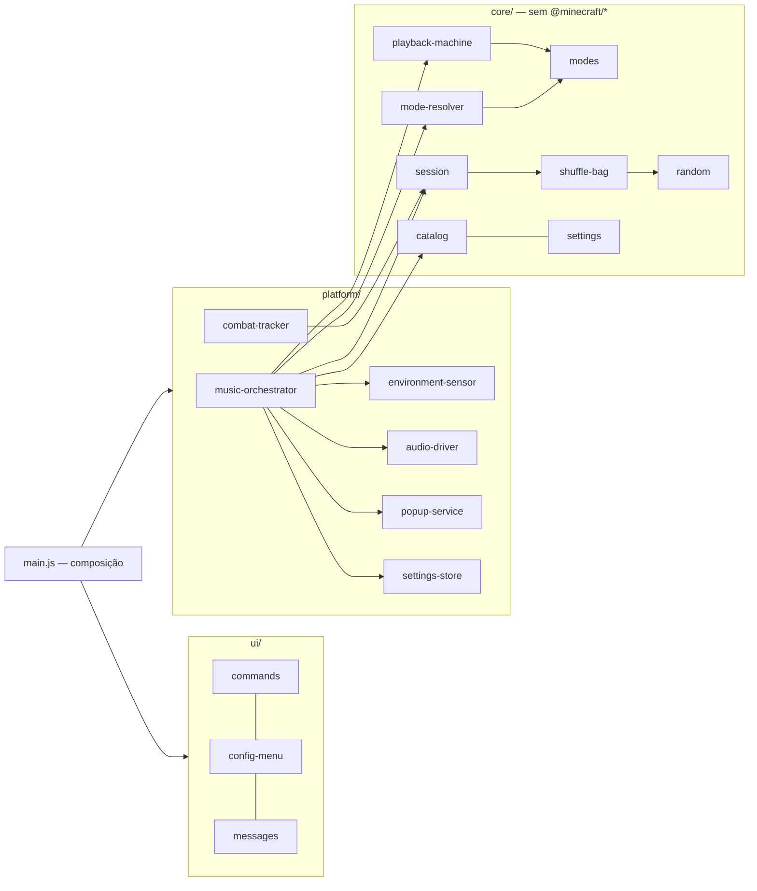

# Arquitetura

## Camadas

- **core/** não importa `@minecraft/*`: é testado em Node puro e reutilizável fora do jogo.
- **platform/** adapta o mundo do jogo para dados (`EnvironmentSnapshot`) e traduz decisões em chamadas de API (`playMusic`, `spawnEntity`).
- **ui/** contém formulário, comandos e textos. `main.js` é a única raiz de composição (injeção de dependências por construtor).

## Fluxo por jogador (a cada `pollTicks`)

1. `EnvironmentSensor.read` → `EnvironmentSnapshot` (consultas caras de entidades e bioma ficam em cache por `proximityTtlTicks`).
2. `resolveMode` → modo desejado (chefe > combate > dimensão > subsolo > vila > clima > noite > exploração).
3. `step(state, desired, now, ctx)` → nova `PlaybackState` + ação (`play`, `gap`, `none`). Função pura e determinística (RNG injetável).
4. `MusicOrchestrator` executa a ação: `AudioDriver`, pop-up, bolsa de sorteio.

O laço usa `system.runJob` (um jogador por fatia de tick) com trava contra sobreposição.

## Máquina de reprodução

Fases: `idle → track ⇄ gap`. Cada modo tem um perfil (`modes.js`):

| Propriedade  | Significado                                                    |
| ------------ | -------------------------------------------------------------- |
| `interrupts` | entrar no modo corta a faixa atual (crossfade)                 |
| `chained`    | enquanto o modo persiste, próxima faixa sem silêncio            |

Regras: ambiente→ambiente espera o fim natural; sair de modo de interrupção para ambiente exige `exitDebounceTicks` e abre um silêncio de liberação; o silêncio é escalado pela preferência de frequência do jogador.

## Limites conhecidos

- A duração das faixas é declarada em `core/catalog.js`: o Script API estável não expõe um evento de fim de música (`SoundInstance` e `SoundCompletedAfterEvent` estão em _beta_). Se o API estabilizar, `step` pode receber o fim real em vez de `untilTick`.
- O volume de uma faixa em execução não pode ser alterado na API estável; mudanças de volume valem a partir da próxima faixa. Desligar a música, por outro lado, tem efeito imediato.
- O clima só é conhecido após a primeira mudança observada (a API estável não permite lê-lo diretamente); até lá assume-se tempo limpo.
- O pop-up é uma entidade no mundo: outros jogadores muito próximos podem vê-lo.
- `dragonsreach` e `the_bannered_mare` existem em `sound_definitions.json`, mas não estão em nenhuma playlist (falta a duração exata de cada um).

## Como adicionar uma faixa

1. Coloque o `.ogg` em `SDM_RP/sounds/music/skyrim/`.
2. Registre `skyrim:track.<nome>` em `SDM_RP/sounds/sound_definitions.json`.
3. Em `core/catalog.js`, adicione a linha em `TRACK_TABLE` (nome, duração em segundos, título) e o nome nas playlists desejadas.
4. `npm test` valida que toda faixa do catálogo está registrada.

## Como adicionar um modo

Adicione-o em `modes.js` (id + perfil), uma playlist em `catalog.js` e a regra em `mode-resolver.js`; o teste de consistência exige playlist para todo modo.

## Referências

- Knuth, D. E. _The Art of Computer Programming_, vol. 2 — algoritmo P (embaralhamento Fisher–Yates).
- Gamma et al. _Design Patterns_ — injeção de dependências e _State_ aplicados à máquina de reprodução.
- Martin, R. C. _Clean Architecture_ — regra de dependência (core ← platform ← ui).
- Documentação oficial do Script API: https://learn.microsoft.com/minecraft/creator/scriptapi/
